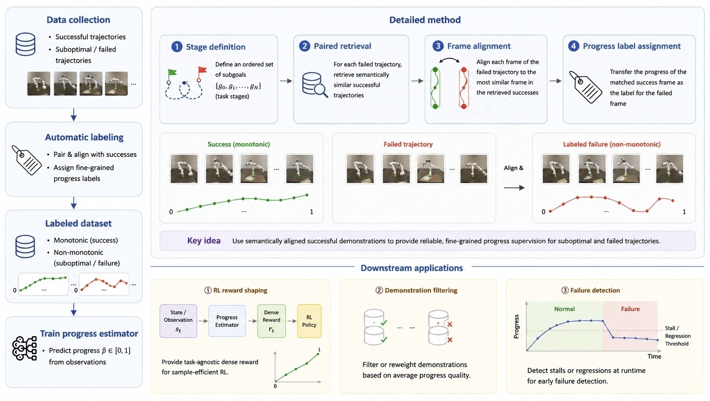

# RoboFAPE

RoboFAPE assigns frame-level progress labels to naturally failed robot trajectories through stage-based alignment with successful references. This repository provides the core trajectory collection and progress labeling pipeline, task configurations, and reproducible examples.



*Overview of the paper. This release focuses on trajectory collection and progress labeling.*

## Installation

Python 3.10 or newer is required for offline labeling. From the repository root:

```bash
python -m venv .venv
source .venv/bin/activate
python -m pip install .
robofape --help
```

For collection, use Linux x86-64 with an NVIDIA GPU and a working Vulkan driver.
See [reproduction](docs/reproduction.md) for dependencies, assets, and checkpoints.

## Offline labeling

Run this small **analytical example** to inspect the matching algorithm without
a simulator, checkpoint, or API key:

```bash
robofape label --input examples/analytical/failure.json \
  --references examples/analytical/references.json --output outputs/analytical
robofape validate outputs/analytical/manifest.json
python scripts/check_example.py outputs/analytical/failure/trajectory.json
```

The example is a hand-calculated test case, not a collected robot trajectory.
The expected progress is `[0.5, 1.0, 0.25]`, including regression. A real trajectory
sample bundle is a [release prerequisite](docs/release_checklist.md) and is not
included in this development version.

## Trajectory collection

After installing the collection environment and downloading task assets:

```bash
robofape collect-success --task PushCube-v1 --count 2 \
  --seed-start 1000 --max-attempts 100 --output outputs/push-success

# Start a compatible learned policy in a separate terminal; see checkpoint setup.
robofape collect-failure --task PushCube-v1 --count 2 \
  --seed-start 2000 --max-attempts 100 \
  --references outputs/push-success/manifest.json \
  --policy-socket robofape-policy.sock --output outputs/push-failure

robofape label --input outputs/push-failure/manifest.json \
  --references outputs/push-success/manifest.json --output outputs/push-labeled
robofape validate outputs/push-labeled/manifest.json
```

Failures are generated by learned-policy execution, optionally following a
motion-plan prefix. No scripted error injection is used. Checkpoints are not
distributed. The policy must meet the documented [inference contract](docs/policy.md).

## Tasks and data

`robofape tasks` lists the 20 packaged task configurations: the 12 training tasks
and eight OOD task/object settings. See the [task matrix](docs/tasks.md),
[data format](docs/data_format.md), and [labeling specification](docs/labeling.md).

This is a development release: offline checks and Linux/GPU collection acceptance
are tracked separately in the [release checklist](docs/release_checklist.md).
Configurations present in the package are not a claim of completed runtime validation.

## Citation and license

Please cite **Failure-Aware Progress Estimation for Robot Learning** when using
RoboFAPE. This repository implements the collection and labeling procedure;
it does not reproduce the paper's estimator training or downstream numerical results.

Code: [MIT](LICENSE). Required third-party notices: [NOTICE.md](NOTICE.md).
